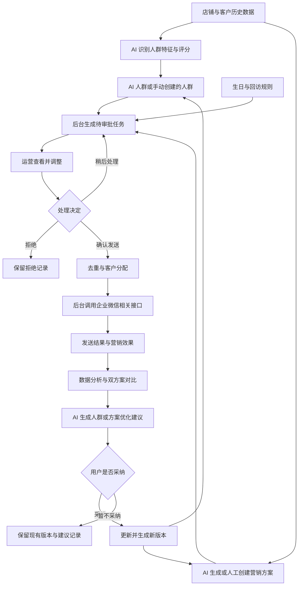

# 触达 · 智能营销运营 App 产品说明

> 文档版本：V1.0  
> 更新日期：2026 年 10 月 11 日  
> 产品形态：手机端运营 App  
> 文档依据：本轮对话中已确认的产品需求、后续调整及 Figma 静态页面  
> 当前交付阶段：产品需求与静态设计，尚未开发实际 App

---

## 目录

1. [产品定位与目标](#1-产品定位与目标)
2. [需求基线与文档使用方式](#2-需求基线与文档使用方式)
3. [核心业务概念](#3-核心业务概念)
4. [整体业务流程](#4-整体业务流程)
5. [信息架构与导航](#5-信息架构与导航)
6. [全局编号与展示规范](#6-全局编号与展示规范)
7. [人群模块](#7-人群模块)
8. [方案模块](#8-方案模块)
9. [生日与定期回访规则](#9-生日与定期回访规则)
10. [发送审批模块](#10-发送审批模块)
11. [AB 测试与分配规则](#11-ab-测试与分配规则)
12. [交叉人群与触达去重](#12-交叉人群与触达去重)
13. [数据模块](#13-数据模块)
14. [AI 建议与持续优化](#14-ai-建议与持续优化)
15. [版本、快照与操作留痕](#15-版本快照与操作留痕)
16. [主要业务对象与字段](#16-主要业务对象与字段)
17. [静态页面设计规范](#17-静态页面设计规范)
18. [现有 Figma 页面清单与统一进度](#18-现有-figma-页面清单与统一进度)
19. [异常情况与边界处理](#19-异常情况与边界处理)
20. [完整业务示例](#20-完整业务示例)
21. [产品验收清单](#21-产品验收清单)
22. [仍需在开发前细化的业务口径](#22-仍需在开发前细化的业务口径)
23. [本阶段交付边界](#23-本阶段交付边界)

---

## 1. 产品定位与目标

### 1.1 产品是什么

「触达」是一款面向运营人员的手机端营销管理 App。

后台连接店铺业务数据与企业微信相关接口，利用 AI 生成人群画像、营销方案和待审批发送任务。运营人员在 App 内查看、调整并确认发送，后台再执行客户触达，并将营销结果回流到数据分析与 AI 优化流程。

产品围绕以下业务闭环展开：

**理解人群 → 准备方案 → 人工确认发送 → 查看效果 → 采纳 AI 建议 → 更新人群或方案 → 再次验证。**

### 1.2 产品解决的问题

| 问题 | 产品处理方式 |
| --- | --- |
| 运营难以从客户历史行为中快速识别相似特征 | 后台 AI 生成结构化人群，使用统一量表展示 |
| 人群名称繁杂，运营不容易记住 | 使用固定人群编号，并展示核心评分 |
| 营销方案缺少明确用途 | 为方案指定主要目的和适用客户阶段 |
| 用途相同的多套方案不容易区分 | 使用固定且唯一的方案编号 |
| 每次发送需要重复组织内容和客户 | 后台自动生成待审批任务，运营只需核对和调整 |
| 无法判断哪套方案效果更好 | 对最多两套方案进行 A/B 测试，并比较同一时间范围的效果 |
| 客户属于交叉人群，容易收到重复消息 | 发送时按优先级去重 |
| AI 优化过程缺乏人工控制 | AI 先提出建议，用户确认采纳后再更新 |
| 内容修改后无法追溯历史发送 | 人群、方案保留历史版本，发送记录保留当时快照 |

### 1.3 主要产品目标

1. 让运营快速看懂每一类人群的关键特征。
2. 让每套营销方案的目的明确、内容可管理。
3. 让所有发送都经过人工确认。
4. 让 A/B 测试中的方案分配清楚、可调整、可追踪。
5. 让运营能够在相同时间、人群条件下比较方案效果。
6. 让 AI 优化建立在真实历史数据上，并由用户决定是否采纳。
7. 让人群、方案、审批和发送过程都有可追溯的记录。

### 1.4 使用者与使用范围

- 使用者统一按运营人员理解。
- 当前不展开运营、审批人、管理员等多角色权限设计。
- 产品是运营端 App，不包含面向消费者的 App。
- 人群展示是宏观画像，不展示客户名单或单个客户资料。
- 产品按通用营销工具设计，不绑定特定行业或商品品类。

---

## 2. 需求基线与文档使用方式

### 2.1 已确认需求

以下内容构成本轮产品需求基线：

| 项目 | 已确认要求 |
| --- | --- |
| 主模块 | 人群、方案、发送审批、数据 |
| 视觉 | 纯黑、白、灰的手机端设计 |
| 原型形态 | 静态页面，无动画，无页面跳转连线 |
| 人群来源 | AI 生成与手动创建均支持 |
| 人群字段 | 允许自定义字段、维度及属性值，具体识别与填充交给后台 AI |
| 画像维度 | 消费水平、购买频次、价格敏感度、新品偏好、经典款偏好、主要品类 |
| 人群首页 | 编号；默认三个核心评分；展开显示完整六项画像 |
| 人群详情 | 编号；完整六项画像；编辑和历史版本入口 |
| 客户归属 | 一个客户可以属于多个人群 |
| 发送去重 | 对交叉人群按优先级处理，避免客户重复接收营销消息 |
| 方案命名 | 使用方案编号，不依赖单独起业务名称 |
| 方案目的 | 新客培育、首购转化、复购促进、价值提升、关系维护、流失召回 |
| 方案首页 | 每条仅展示编号、目的、适用客户，点击后进入独立详情页 |
| 方案详情 | 展示完整话术、搭配内容、关联人群、版本记录和编辑入口 |
| 方案来源 | AI 生成与手动创建均支持 |
| 店铺资源 | 优惠券、抽奖、商品从店铺已有资源中选择 |
| 周期配置 | 生日与回访周期支持在 App 内配置 |
| 发送确认 | 所有发送均需人工确认，定时规则只生成待审批卡片 |
| 审批调整 | 可更换人群、更换或添加方案、调整方案比例 |
| 内容修改边界 | 人群规则与方案具体内容在对应模块修改 |
| A/B 测试 | 最多两个方案；每个客户仅接收其中一个方案 |
| 测试适用范围 | 定制化、生日、定期回访营销均支持 |
| AI 推荐比例 | AI 可推荐分配比例，运营可手动调整 |
| 审批处理 | 支持稍后处理与拒绝，保留操作记录 |
| 发送状态 | 等待发送、发送中、发送成功、部分失败、发送失败 |
| 失败处理 | 提供重试入口 |
| 数据时间范围 | 近 7 日、近 30 日、近 3 个月 |
| 数据筛选 | 时间、人群、方案 |
| 基础指标 | 触达人数、成交人数、订单数、成交金额及合理的转化指标 |
| 方案比较 | 只比较同一时间范围的数据；不限于同一次 A/B 测试，优先同组测试 |
| AI 更新 | 先生成建议，用户确认采纳后更新 |
| 历史 | 人群和方案保留历史版本 |

### 2.2 设计假设

为完成产品设计，本阶段采用以下假设：

1. 后台可以获得设计所需的客户订单、商品、销售、实付金额及相关历史数据。
2. 后台可以计算画像评分并识别自定义字段。
3. 后台可以从店铺读取优惠券、抽奖和商品资源。
4. 后台可以生成建议、发送任务并回收发送与成交数据。
5. 页面内的客户数量、评分、金额、日期、品类占比和营销结果均为设计示例。

这些假设用于需求和界面设计，不代表已经核实或实现了具体平台接口能力。

### 2.3 建议规则与待细化内容

本说明会补充完成业务闭环所需要的规则。例如编号不重复、任务引用版本快照、重试只处理失败客户等。

其中尚未由用户明确指定的细节，会标为「建议规则」或列入文末的待细化事项。它们用于指导后续产品与开发讨论，不应被误解为已经完成开发或已经确定全部技术实现。

---

## 3. 核心业务概念

| 概念 | 定义 | 与其他概念的关系 |
| --- | --- | --- |
| 客户 | 后台识别的具体营销对象 | 可以属于多个人群，App 不展示单个客户资料 |
| 人群 | 具有相似特征，或满足一组条件的客户集合 | 使用编号识别，可关联多套方案 |
| 画像维度 | 用于描述客户或人群特征的结构化项目 | 包含五项评分及主要品类，也支持扩展字段 |
| 人群规则 | 决定哪些客户归入该人群的条件 | 与画像评分不同；规则定义集合，评分描述集合特征 |
| 营销方案 | 具有明确目的、适用客户和具体内容的营销内容集合 | 不直接等同于一次发送，可用于不同人群 |
| 方案目的 | 希望通过营销达成的业务变化 | 每套方案有一个主要目的 |
| 适用客户 | 方案适合的客户阶段 | 是适用说明，不等于最终发送名单 |
| 触达规则 | 根据日期、周期或业务条件生成任务的配置 | 只生成待审批任务，不自动发送 |
| 发送任务 | 某次准备向目标客户发送一套或两套方案的工作项 | 包含人群、方案版本、比例、范围和处理状态 |
| 审批 | 运营核对并处理发送任务的动作 | 确认后才执行发送 |
| A/B 测试 | 将客户分配到两套方案，比较营销效果的方法 | 属于验证方式，不属于营销目的分类 |
| AI 建议 | 后台提出的人群或方案改进建议 | 用户采纳后才产生更新 |
| 历史版本 | 人群规则或方案内容的历史状态 | 用于追溯、比较，避免旧记录随最新内容变化 |
| 发送快照 | 某次发送最终采用的人群、方案、比例等信息 | 发送结果与数据分析以该快照为依据 |

### 3.1 人群与方案是多对多关系

- 同一个人群可以使用多个方案。
- 同一个方案可以被不同人群使用。
- 同一人群、同一目的可以存在多个不同方案，用于测试不同话术或搭配内容。
- 一个方案关联了某个人群，不代表它已经发送给这个人群。
- 最终发送范围由发送任务确定。

### 3.2 客户阶段、营销目的与发送条件应区分

例如：

- 「已购客户」是客户阶段。
- 「复购促进」是营销目的。
- 「三个月回访」是触达规则。
- 「方案 01 与方案 02 对比」是测试安排。

这四类信息不能相互替代，也不应合并成一个冗长的方案名称。

---

## 4. 整体业务流程

### 4.1 完整营销闭环



### 4.2 运营的典型使用路径

1. 打开人群页面，了解各类客户的消费与偏好特征。
2. 打开方案页面，按目的和适用客户筛选方案。
3. 在发送审批页面查看后台生成的任务。
4. 核对人群编号、核心评分、方案目的及适用客户。
5. 根据需要更换人群、方案或测试比例。
6. 点击确认发送。
7. 在已发送列表查看状态和失败情况。
8. 在数据页面选择时间、人群、方案，比较效果。
9. 查看 AI 建议，决定是否采纳。
10. 后续营销使用确认后的新版本继续验证。

### 4.3 自动化与人工控制的边界

后台自动处理：

- 数据识别与聚合。
- 人群画像和评分计算。
- AI 方案及优化建议生成。
- 待审批任务生成。
- 去重、分组与发送执行。
- 发送结果和营销效果回收。

人工处理：

- 创建或编辑人群规则。
- 创建或编辑营销方案。
- 配置生日与回访规则。
- 选择任务使用的人群、方案和比例。
- 采纳或不采纳 AI 建议。
- 确认发送、稍后处理、拒绝、发起失败重试。

**自动生成任务不等于自动发送。**

---

## 5. 信息架构与导航

### 5.1 四个主模块

| 底部导航 | 模块定位 | 主要内容 |
| --- | --- | --- |
| 人群 | 管理营销对象的宏观特征 | 人群列表、完整画像、规则编辑、自定义字段、AI 建议、历史版本 |
| 方案 | 管理营销内容与目的 | 方案列表、详情、创建编辑、店铺资源、触达规则、AI 建议、历史版本 |
| 发送审批 | 决定本次发送什么、发给谁 | 待审批任务、任务调整、A/B 比例、已发送状态、重试、处理记录 |
| 数据 | 查看结果并支持优化 | 时间与编号筛选、指标汇总、双方案趋势、方案效果对比、AI 建议入口 |

### 5.2 主页面与二级页面

- 主页面保留四项底部导航。
- 二级详情和编辑页面提供返回入口。
- 详情页以查看信息为主，提供明确的编辑入口。
- 编辑页处理内容或规则变更，不把完整编辑表单放在主列表里。
- 发送审批中的“查看并调整”只调整本次任务的选择与比例。
- 历史版本、建议详情、选择器、确认弹窗分别承担独立职责。

### 5.3 静态设计中的入口

本阶段会画出按钮、筛选器、详情入口及确认界面的外观，但不制作点击跳转、动画或真实交互。

因此，页面上出现“历史版本”“更换方案”“确认发送”等入口，仅代表预期产品功能，不代表当前 Figma 已经能够执行这些操作。

---

## 6. 全局编号与展示规范

### 6.1 人群编号

展示格式：

- 人群 01。
- 人群 02。
- 人群 03。

建议规则：

1. 人群创建后获得唯一编号。
2. 编号不因列表排序、筛选或评分更新而变化。
3. 编辑规则时沿用编号，以版本号区分内容变化。
4. 停用或删除后不把原编号重新分配给另一类人群。
5. 两位数字是最小显示长度，数量超过 99 后自然扩展。
6. 后台可以保留内部唯一 ID，界面主要展示运营可读的编号。
7. 若人群发生拆分或合并，建议生成新编号，并记录来源关系。

### 6.2 方案编号

展示格式：

- 方案 01。
- 方案 02。
- 方案 03。

建议规则与人群编号一致：固定、唯一、不随排序改变、不重复使用。

方案内容更新后仍叫“方案 01”，但版本从 V1 更新为 V2、V3。

### 6.3 编号与版本的分工

| 信息 | 解决的问题 | 示例 |
| --- | --- | --- |
| 编号 | 这是哪一个业务对象 | 人群 01、方案 01 |
| 版本 | 这个对象的哪一次内容状态 | V1、V2、V3 |
| 更新时间 | 内容最近何时改变 | 2026/10/09 14:30 |
| 任务编号 | 这是哪一次发送安排 | 任务 01 |

时间不承担唯一识别作用。更新时间可能变化，不适合作为区分两套用途相同方案的主要标识。

### 6.4 各模块的统一展示

| 页面 | 人群展示 | 方案展示 |
| --- | --- | --- |
| 人群首页 | 编号＋三个核心评分 | 不作为主要内容 |
| 人群详情 | 编号＋完整六项画像 | 关联方案使用编号 |
| 方案首页 | 适用客户阶段，不展开具体人群 | 编号＋目的＋适用客户 |
| 方案详情 | 关联人群使用编号 | 编号、目的、适用客户、完整内容、版本 |
| 发送审批 | 编号＋三个核心评分 | 编号＋目的＋适用客户 |
| 数据首页 | 按人群编号筛选 | 按方案编号筛选，并在图例和对比表保持一致 |

---

## 7. 人群模块

### 7.1 模块目标

将客户特征转化为运营能够理解、比较和使用的结构化人群。

运营不需要记住复杂的业务名称，也不需要查看客户名单，而是通过编号和统一量表判断某类人群适合什么样的营销方案。

### 7.2 人群来源

| 来源 | 生成方式 | 运营能力 |
| --- | --- | --- |
| AI 创建 | 后台基于历史数据识别相似特征并生成 | 查看、编辑规则、查看建议、采纳更新、查看历史 |
| 手动创建 | 运营设定维度、字段和属性值 | 创建、修改规则，交由 AI 识别和填充 |

手动创建人群不代表评分由运营手动填写。五项画像评分仍由后台 AI 计算。

### 7.2.1 可供后台使用的数据

最初需求涉及性别、头像、昵称、地区等基础资料；后续又明确可以假定后台获得订单、销售和支付历史。最终人群展示采用六项结构化画像，基础资料可以作为后台识别和自定义规则的候选输入，不增加客户个人资料页面。

| 数据类别 | 需求涉及的信息 | 产品中的用途 |
| --- | --- | --- |
| 基础资料 | 性别、头像、昵称、地区 | 后台识别、地区等自定义条件；不在 App 展示个人资料 |
| 订单历史 | 订单、购买时间、购买次数、购买间隔 | 购买频次、客户阶段和回访条件 |
| 销售与支付 | 商品价格、实际支付金额、历史成交 | 消费水平与成交指标 |
| 商品信息 | 商品、品类、新品／经典款标记、购买链接 | 偏好画像与方案搭配 |
| 优惠与活动 | 店铺已有券、抽奖及相关使用结果 | 激励选择、价格敏感度参考及扩展指标 |
| 营销记录 | 任务、分组、发送结果、归因成交 | 效果比较、AI 建议与版本追溯 |

其中新品、经典款、活动使用结果等信息的具体识别依据属于后台实现细节。原始资料有缺失时，应明确显示识别依据不足，不能凭空补成确定结论。

### 7.3 六项标准画像

| 维度 | 展示方式 | 描述的含义 | 可参考的数据依据 |
| --- | --- | --- | --- |
| 消费水平 | 1–5 档评分 | 在当前店铺业务中表现出的实际消费水平 | 历史实付金额、实付客单价、购买商品价格区间 |
| 购买频次 | 1–5 档评分 | 在统一观察周期内购买的频繁程度 | 购买次数、支付时间、购买间隔 |
| 价格敏感度 | 1–5 档评分 | 购买行为受到价格变化和优惠的影响程度 | 促销期购买行为、券使用、不同价格下的购买变化 |
| 新品偏好 | 1–5 档评分 | 对新上市产品的偏好程度 | 新品购买比例、新品相关行为 |
| 经典款偏好 | 1–5 档评分 | 对长期在售、稳定产品的偏好程度 | 经典款购买比例、持续复购行为 |
| 主要品类 | 标签与占比 | 该人群主要偏好的商品类别 | 购买品类及相关历史行为 |

数据依据是评分设计的参考，不代表本阶段确定了具体算法。

### 7.4 评分的通用含义

| 分值 | 通用展示含义 |
| --- | --- |
| 1 / 5 | 低 |
| 2 / 5 | 偏低 |
| 3 / 5 | 中 |
| 4 / 5 | 偏高 |
| 5 / 5 | 高 |

需要注意：

- 五项分数分别描述不同特征，不计算一个“综合优质客户分”。
- 高分不一定代表更好的客户。价格敏感度高，意味着更可能受价格或优惠影响。
- 消费水平是实际交易表现，不根据头像、昵称、性别或地区推断个人财富。
- 新品偏好与经典款偏好分别计算，一个客户可能同时偏好两者。
- 主要品类是类别分布，不强行转换成单个 1–5 分。

### 7.4.1 各维度的解释锚点

以下为建议的运营解释量表，用于让分数可读，不作为已经确定的算法阈值。实际金额、次数、比例和分档边界由后台量表定义。

| 维度 | 1 分 | 2 分 | 3 分 | 4 分 | 5 分 |
| --- | --- | --- | --- | --- | --- |
| 消费水平 | 在店铺中处于较低消费档 | 偏低消费档 | 中等消费档 | 偏高消费档 | 较高消费档 |
| 购买频次 | 观察期内购买很少 | 购买偏少 | 购买频次中等 | 购买较频繁 | 购买很频繁 |
| 价格敏感度 | 对优惠与价格变化反应较弱 | 反应偏弱 | 反应中等 | 较受价格或优惠影响 | 明显受价格或优惠影响 |
| 新品偏好 | 新品购买倾向较弱 | 偏弱 | 中等 | 偏强 | 新品购买倾向明显 |
| 经典款偏好 | 经典款购买倾向较弱 | 偏弱 | 中等 | 偏强 | 经典款购买倾向明显 |

画像说明应描述数据表现。例如“观察期内购买偏少”比“客户购买意愿低”更准确；单靠购买频次不能断言客户的真实意愿。消费水平也不等同于个人收入或财富。

### 7.5 量表的一致性

建议规则：

1. 同一店铺、同一量表版本下，不同人群使用一致的分档标准。
2. 观察周期、评分方法和阈值应可追踪。
3. 评分方法变化时应生成新的量表版本，不静默改写旧版本的解释。
4. 界面可在“评分说明”中展示维度含义、数据范围和更新时间。
5. 数据不足时显示“待识别”或“依据不足”，不把缺失数据当作低分。
6. 人群总体评分是摘要，不能被理解为组内每个客户的分数都相同。

### 7.6 人群规则与画像结果

二者需要区分：

- **规则**：决定客户是否属于该人群。
- **画像**：描述已经属于该人群的客户整体具有什么特征。

例如，一个人群规则是“近 90 日有购买记录”，它的人群画像可能是“消费水平 4、购买频次 2、新品偏好 5”。

运营修改规则后，后台重新识别成员并计算画像；不能简单把界面中的消费水平从 3 改成 5，就视为真实人群已经改变。

### 7.7 自定义字段

已确认支持自定义字段、维度和属性值。

建议字段配置包含：

| 字段 | 说明 |
| --- | --- |
| 字段名称 | 运营可读的维度名称 |
| 字段说明 | 帮助 AI 和运营理解该字段含义 |
| 属性值 | 例如低、中、高，或一组业务类别 |
| 字段类型 | 分类、数值、日期、布尔等，具体类型在开发阶段细化 |
| 识别依据 | AI 计算或识别时参考的业务信息 |
| 使用状态 | 是否仍用于当前规则 |
| 字段版本 | 字段定义发生变化时保留历史 |

建议将字段定义放入共享的字段字典，避免不同人群中同名字段含义不同。

### 7.8 人群首页

默认展示：

1. 人群编号。
2. 覆盖人数。
3. 消费水平。
4. 购买频次。
5. 价格敏感度。

展开后额外展示：

- 新品偏好。
- 经典款偏好。
- 主要品类及占比。

页面其他内容：

- 人群数量与去重后的覆盖客户数量。
- AI 创建／手动创建筛选。
- AI 优化建议入口。
- 新建人群入口。
- 查看详情入口。
- 人群可交叉、发送按优先级去重的说明。

### 7.9 人群详情

详情页完整展示六项画像，不需要再次展开才能查看。

内容顺序：

1. 人群编号、覆盖人数、来源、当前版本。
2. 完整五项评分、评分条和简短解释。
3. 主要品类的占比展示。
4. AI 优化建议入口。
5. 关联方案编号。
6. 最近更新时间与历史版本入口。
7. 底部编辑人群按钮。

当前示例：

| 项目 | 人群 01 示例 |
| --- | --- |
| 覆盖人数 | 8,420 人 |
| 消费水平 | 4 / 5，偏高 |
| 购买频次 | 2 / 5，偏低 |
| 价格敏感度 | 1 / 5，低 |
| 新品偏好 | 5 / 5，高 |
| 经典款偏好 | 2 / 5，偏低 |
| 主要品类 | 品类 A 60%、品类 B 30%、其他 10% |

上述占比仅为通用设计示例。正式统计中，应统一占比的分母，例如按购买件数、订单或消费金额计算；具体口径尚待细化。

### 7.10 人群编辑

编辑对象包括：

- 特征条件。
- 使用的字段与属性值。
- 条件关系。
- AI 识别所需的字段说明。

编辑后应反馈：

- 预计覆盖情况。
- 后台识别是否完成。
- 新画像是否可用。
- 是否生成了新版本。

本阶段不展示具体客户名单或客户资料。

---

## 8. 方案模块

### 8.1 模块目标

让营销内容具有明确目的、适用对象和可追踪版本，并支持在不同人群之间复用。

### 8.2 方案来源

- AI 生成。
- 运营手动创建。
- 运营编辑 AI 生成方案。
- 用户采纳 AI 优化建议后形成新版本。

### 8.3 六类主要目的

每套方案选择一个主要目的。

| 目的 | 希望发生的业务变化 | 常见内容方向 | 适用客户举例 |
| --- | --- | --- | --- |
| 新客培育 | 从刚建立联系到了解店铺、产品与服务 | 欢迎介绍、使用知识、产品知识、需求了解 | 新建立联系客户、未首购客户 |
| 首购转化 | 从未购买到完成第一笔购买 | 首购权益、入门产品推荐、购买疑问解答 | 未首购客户 |
| 复购促进 | 从已经购买到再次购买 | 补货提醒、产品关怀、回购权益、相关产品推荐 | 已购客户、持续复购客户 |
| 价值提升 | 提升单次购买金额或扩大购买品类 | 组合推荐、产品升级、跨品类推荐 | 已购客户、持续复购客户 |
| 关系维护 | 保持联系、改善体验和长期购买意愿 | 生日祝福、售后关怀、会员权益提醒 | 各阶段客户，可不限阶段 |
| 流失召回 | 让长期未购买或低活跃客户重新产生购买意愿 | 回归权益、需求询问、久未购买回访 | 低活跃客户、长期未购客户 |

### 8.4 适用客户阶段

建议采用统一的客户阶段选项：

- 新建立联系。
- 未首购。
- 已首购／已购。
- 持续复购。
- 低活跃。
- 长期未购。
- 不限客户阶段。

适用客户阶段与具体人群是不同层级的信息：

- “已购客户”说明方案适合什么阶段。
- “人群 01”说明某次营销或方案关联具体使用哪类客户。

一个阶段可以对应多个人群。阶段的识别阈值在后台定义，不在列表中展示复杂规则。

### 8.5 方案内容结构

| 内容 | 功能要求 |
| --- | --- |
| 固定编号 | 唯一识别方案 |
| 主要目的 | 六类目的之一 |
| 适用客户 | 客户阶段说明 |
| 完整话术 | 实际准备发送的内容 |
| 搭配内容 | 优惠券、抽奖或商品购买链接等 |
| 关联人群 | 可以使用该方案的人群编号 |
| 来源 | AI 创建或手动创建 |
| 当前版本 | 最新可使用的内容版本 |
| 时间记录 | 创建时间、更新时间 |
| 历史记录 | 历史版本与 AI 建议采纳情况 |

### 8.6 全量与定制化营销

原始业务分类仍然有效，但不作为当前方案首页列表的主要展示信息。

**全量条件营销：**

- 指面向所有满足某项业务条件的客户。
- 例如当天生日的客户、已经到达回访周期的客户。
- 不是每次向全部客户发送。
- 内容通常包含话术与优惠券、抽奖等激励。

**定制化营销：**

- 面向选定人群的营销。
- 内容通常包含针对该人群的话术与商品购买链接。
- 可以由 AI 生成，也可以人工创建。

具体方案可选择哪类资源、资源是否允许组合，需要在开发前进一步确定。当前原型以优惠券、抽奖、商品选择的典型情况展示。

### 8.7 场景与周期不占用首页列表

- 方案首页不展示生日、回访等场景标签。
- 场景不作为当前方案分类的必填维度。
- 生日日期、回访间隔和任务生成时间属于触达规则。
- 话术可以体现生日或回访语境，但不需要把所有信息拼接成方案名称。

### 8.8 方案首页

每条方案记录只展示三个信息：

1. 编号。
2. 目的。
3. 适用客户。

示例：

```text
方案 01                         ›
目的：复购促进
适用客户：已购客户

方案 02                         ›
目的：复购促进
适用客户：已购客户
```

首页包含：

- 创建方案按钮。
- 按编号搜索。
- 按目的筛选。
- 按适用客户筛选。
- 方案数量。
- 简洁列表。

话术、激励、商品、来源、版本和更新时间放入详情页，不加入每条列表记录。

### 8.9 独立方案详情

点击列表记录后，在正式 App 中进入独立详情页。

详情包含：

1. 方案编号、版本、目的和适用客户。
2. 完整话术。
3. 搭配的优惠券、抽奖或商品链接。
4. 关联人群编号。
5. 创建来源、创建日期、更新时间。
6. AI 建议采纳状态。
7. 历史版本入口。
8. 编辑方案入口。

### 8.10 方案创建与编辑

已确认需要完整的创建和编辑页面。

主要操作：

- 选择主要目的。
- 指定适用客户。
- 编辑话术。
- 从店铺资源列表选择搭配内容。
- 关联人群。
- 保存方案或新版本。

保存前的建议校验：

1. 主要目的和适用客户有效。
2. 话术不为空。
3. 引用的资源仍可使用。
4. 链接与资源信息可识别。
5. 明确此次保存是否产生新版本。

### 8.11 用途相同与内容重复

两套方案的目的、适用客户相同是正常情况，不能视为重复错误。

例如方案 01 和方案 02 都服务于已购客户的复购促进，但可以测试不同话术或激励。

建议规则：

- 用编号区分用途相同的方案。
- 创建或保存时，若话术和搭配内容高度相似，可提示与已有方案相似。
- 相似提示是辅助判断，不自动合并或删除方案。
- 是否仍保留新方案由运营决定。
- 相似检测规则尚未确定，属于后续细化内容。

### 8.12 店铺资源管理边界

App 只读取和选择店铺已有资源。

| 资源 | App 内支持 | App 内不包含 |
| --- | --- | --- |
| 优惠券 | 列表、选择、查看金额门槛与有效期等信息 | 创建优惠券或制定券活动 |
| 抽奖 | 列表、选择、查看活动信息 | 创建抽奖及奖品配置 |
| 商品 | 列表、选择、关联购买链接 | 创建商品、编辑店铺商品资料 |

资源创建与完整管理在店铺侧完成。

---

## 9. 生日与定期回访规则

### 9.1 规则作用

根据日期或周期，定时生成待审批任务。

**规则到期 → 生成卡片 → 运营确认 → 后台发送。**

### 9.2 生日规则

规则围绕符合生日条件的客户生成任务。

建议配置项：

- 规则启用状态。
- 生日条件。
- 待审批卡片生成时间。
- 关联方案。
- 单方案或双方案测试。
- 默认分配比例或 AI 推荐比例。

生日信息的具体来源由后台业务数据决定，本说明不假定企业微信基础资料天然包含生日。

### 9.3 定期回访规则

已确认支持在 App 内配置回访周期，例如三个月、六个月。

建议配置项：

- 回访周期。
- 周期起算依据。
- 待审批卡片生成时间。
- 符合条件的客户范围。
- 关联方案。
- 是否使用双方案测试。

起算依据尚待细化，例如最近一次购买或最近一次回访。它会影响任务生成范围，应在开发前统一。

### 9.4 规则与方案的关系

- 方案保存具体营销内容。
- 规则保存何时、针对什么条件生成任务。
- 同一个方案可以关联不同规则。
- 修改规则不直接修改方案内容。
- 修改方案不意味着已经生成的历史任务随之改变。

---

## 10. 发送审批模块

### 10.1 模块目标

让运营在发送前清楚地判断：

1. 本次发送给哪类客户。
2. 这些客户具有什么核心特征。
3. 使用哪一套或哪两套方案。
4. 两套方案的目的与适用客户是否合理。
5. 每套方案分配多少客户。
6. 是否立即确认、稍后处理或拒绝。

### 10.2 主状态标签

- 待审批。
- 已发送。

「已发送」作为任务已提交执行的业务列表名称，内部可以包含“等待发送”状态，不表示每条任务都已经完成。

### 10.3 待审批卡片内容

| 区域 | 展示内容 |
| --- | --- |
| 任务信息 | 任务编号、AI 推荐或规则来源、测试标记 |
| 人群信息 | 人群编号、本次预计触达人数 |
| 核心画像 | 消费水平、购买频次、价格敏感度 |
| 方案 A | 方案编号、目的、适用客户 |
| 方案 B | 方案编号、目的、适用客户，双方案时展示 |
| 比例区 | 百分比输入、增减控件、滑杆、预计人数 |
| 提示 | 比例合计 100%，每位客户只接收其中一套方案 |
| 操作 | 查看并调整、确认发送、稍后处理、拒绝 |

### 10.4 当前双方案示例

| 项目 | 示例 |
| --- | --- |
| 目标人群 | 人群 01 |
| 核心评分 | 消费水平 4、购买频次 2、价格敏感度 1 |
| 本次目标客户 | 2,000 人 |
| A 组方案 | 方案 01，复购促进，适用已购客户 |
| B 组方案 | 方案 02，复购促进，适用已购客户 |
| A 组比例 | 30%，预计 600 人 |
| B 组比例 | 70%，预计 1,400 人 |

人群覆盖总人数与本次触达人数不要求相同。本次任务可能只取其中满足规则、去重或可触达条件的客户。

### 10.5 本次任务允许调整的内容

- 更换目标人群。
- 更换所用方案。
- 从单方案增加到双方案。
- 从双方案移除一套，恢复单方案。
- 调整两套方案的比例。
- 恢复 AI 推荐比例。

### 10.6 不在审批页直接修改的内容

- 人群维度定义。
- 人群字段与属性值。
- 人群划分规则。
- 方案完整话术。
- 优惠券、抽奖或商品资源本身。

需要修改这些内容时，进入对应的人群或方案模块。

### 10.7 确认发送

建议在确认界面核对：

- 人群编号与最终预计人数。
- 方案编号与使用版本。
- 单方案或 A/B 分配方式。
- 百分比与预计分组人数。
- 资源是否有效。
- 是否存在版本更新需要处理。

确认后生成不可随意改写的发送快照，并提交后台执行。

### 10.8 稍后处理

- 将任务标记为稍后处理。
- 任务仍属于待审批。
- 可以通过筛选再次找到。
- 不发送任何消息。
- 记录处理人、时间及状态变化。

稍后处理不是定时自动发送。

### 10.9 拒绝任务

- 拒绝后不执行发送。
- 保留任务内容及拒绝动作记录。
- 拒绝原因可作为建议字段，具体是否必填尚待细化。
- 可在处理记录中查看被拒绝任务。

### 10.10 已发送状态

| 状态 | 含义 | 建议可用操作 |
| --- | --- | --- |
| 等待发送 | 已确认，等待后台开始执行 | 查看快照和任务状态 |
| 发送中 | 后台正在执行 | 查看进度 |
| 发送成功 | 当前执行范围发送完成 | 查看结果、查看数据 |
| 部分失败 | 部分客户成功、部分客户失败 | 查看结果、重试失败部分 |
| 发送失败 | 本轮发送执行失败 | 查看原因、发起重试 |

已发送列表通过二级状态筛选展示这些状态，不另设五个底部导航。

### 10.11 失败重试

已确认提供重试入口。建议规则：

1. 重试只处理尚未成功的客户。
2. 已发送成功的客户不重复发送。
3. 重试沿用原方案版本和原分组。
4. 若资源已失效，先处理资源问题，再发起新的有效执行。
5. 重试次数、时间、结果单独记录。
6. 多次重试不能把同一客户重复计入触达人数。

---

## 11. A/B 测试与分配规则

### 11.1 测试范围

- 最多两个方案。
- 支持单方案发送。
- 支持定制化营销测试。
- 支持生日方案测试。
- 支持定期回访方案测试。

### 11.2 可以测试的差异

- 不同话术。
- 不同激励方式。
- 不同优惠力度。
- 不同商品搭配。
- 不同内容组合。

为了便于解释结果，建议一次测试尽量聚焦一个主要变化，而不是同时修改所有内容。

### 11.3 分配比例

- 单方案默认 100%。
- 双方案可以采用 50%／50%、30%／70% 等比例。
- 两套方案比例合计必须为 100%。
- AI 可以推荐比例。
- 运营可以手动调整。
- 页面同时展示预计人数。

建议规则：双方案中任一比例为 0% 时，界面应提示这已经不构成有效双组测试，或转为单方案状态；具体交互尚待细化。

### 11.4 客户互斥

同一次测试中：

- 一个客户只能进入一组。
- 客户接收方案 A 后，不再接收该测试的方案 B。
- 客户接收方案 B 后，不再接收该测试的方案 A。
- 去重先于最终分组人数确定。

### 11.5 比例到人数的转换

由于人数为整数，百分比换算后可能需要取整。

建议规则：

- 后台统一处理取整。
- 两组最终人数之和等于本次实际分配人数。
- 界面显示“预计人数”，最终结果记录实际人数。
- 对小样本任务提示分配后是否存在空组。

### 11.6 测试的可解释性

比较时至少保持：

- 相同时间范围。
- 相同目标人群或清楚说明不同范围。
- 相同指标定义。
- 相同归因口径。

两组比例不同，不能只比较成交人数或成交金额。应同时看触达人数和转化率。

例如 B 组人数更多，成交人数自然可能更多；这不等于方案 B 已经被证明更优。

### 11.7 长期测试建议

若一个实验跨多次发送，建议后台维持该实验内客户分组稳定，避免同一个客户在不同批次来回切换测试方案。

此项属于后续实验管理规则，当前已确认的硬性要求是：每次发送中，客户只接收其中一套方案。

---

## 12. 交叉人群与触达去重

### 12.1 已确认的归属规则

一个客户可以同时属于多个人群。

原因是画像维度较多，同一客户可能同时符合不同的特征条件。强行要求互斥，会限制细分和测试能力。

### 12.2 已确认的发送原则

当客户因交叉人群同时进入多项营销安排时，通过优先级处理，避免客户同时收到多类营销消息。

### 12.3 建议去重流程

1. 汇总本次适用的客户集合。
2. 按统一客户标识识别重复客户。
3. 根据发送优先级，选择该客户本次采用的营销安排。
4. 排除重复安排。
5. 对保留的客户进行单方案或 A/B 分配。
6. 展示最终可触达人数。
7. 记录去重及优先级处理结果。

### 12.4 优先级尚需细化

已确认存在优先级，但尚未指定：

- 优先级由规则、任务还是方案定义。
- 同优先级时如何处理。
- 去重覆盖同一批次、同一天还是一个业务时间窗口。
- 是否存在跨任务的触达间隔限制。

这些细节由后续业务规则决定。当前页面只展示“按优先级去重”的产品原则。

### 12.5 人数统计

- 单个人群覆盖人数：该人群内去重后的客户数量。
- 全部人群覆盖人数：多个所选人群合并后去重的客户数量。
- 多个人群人数不能直接相加作为总客户数。
- 审批预计人数应说明是规则筛选与去重后的本次范围。
- 数据触达人数按统计口径去重，不简单累加发送次数。

---

## 13. 数据模块

### 13.1 模块目标

帮助运营理解营销结果，并通过控制时间、人群和方案条件进行效果比较。

### 13.2 三类筛选

| 筛选 | 功能 |
| --- | --- |
| 时间 | 近 7 日、近 30 日、近 3 个月 |
| 人群 | 按编号选择，如人群 01 |
| 方案 | 按编号选择，可查看单方案或比较两套方案 |

选择时间后显示明确的起止日期。两套方案始终使用同一个起止日期。

「近 30 日」按日数表达，「近 3 个月」按已确认的产品用语表达，不直接替换为固定 90 日或自然季度。正式开发时需明确三个月的日期计算方式、是否包含当日、统计时区以及日／周／月趋势粒度，并在页面显示实际范围。

### 13.3 当前首页示例筛选

- 时间：2026/10/05—10/11。
- 人群：人群 01。
- 方案：方案 01／方案 02。
- 图表指标：成交转化率。

### 13.4 基础指标

| 指标 | 产品定义 | 单位 |
| --- | --- | --- |
| 触达人数 | 统计范围内成功触达的去重客户数 | 人 |
| 成交人数 | 按统一营销归因口径统计的去重支付客户数 | 人 |
| 订单数 | 按同一归因口径统计的有效支付订单数 | 单 |
| 成交金额 | 对应订单的有效成交金额 | 元 |
| 成交转化率 | 成交人数 ÷ 触达人数 × 100% | % |

“有效支付订单”和金额是否扣除退款等细节尚待统一，但同一页面、同一比较必须使用同一个口径。

### 13.5 建议的其他指标

用户已要求支持合理的多种转化指标，建议按数据能力分层提供：

| 指标 | 计算方式或含义 | 使用条件 |
| --- | --- | --- |
| 首购转化率 | 发生首购的客户数 ÷ 被触达的未首购客户数 × 100% | 能识别触达前是否已首购 |
| 复购转化率 | 发生再次购买的客户数 ÷ 被触达的已购客户数 × 100% | 能识别触达前购买阶段 |
| 客单价 | 成交金额 ÷ 订单数 | 有订单与金额数据 |
| 触达人均成交金额 | 成交金额 ÷ 触达人数 | 有归因成交金额 |
| 每触达客户订单产出 | 订单数 ÷ 触达人数 | 有归因订单数 |
| 领券转化率 | 领券客户数 ÷ 对应有效触达客户数 × 100% | 店铺可提供领券数据 |
| 用券转化率 | 使用对应券的成交客户数 ÷ 领券客户数 × 100% | 店铺可提供完整用券数据 |

其中“订单数 ÷ 触达人数”可能大于 1，应作为订单产出指标，不伪装成限制在 0%—100% 的客户转化率。

领券、用券等指标属于有数据时的扩展，不要求当前静态首页全部展示。

### 13.6 首页布局

1. 时间筛选。
2. 统一日期范围。
3. 人群编号、方案编号筛选。
4. 当前范围的合计指标。
5. 成交转化率摘要与其他指标入口。
6. 两套方案的趋势折线图。
7. 方案效果对比表。
8. 示例与指标口径说明。

### 13.7 趋势图

- 横轴：时间。
- 纵轴：当前选择的一个指标。
- 方案 01：实线。
- 方案 02：虚线。
- 图例使用方案编号。
- 纵轴明确单位。
- 可以切换触达人数、成交人数、订单数、成交金额、转化率等指标。

不同单位的指标不直接放在同一个纵轴上。例如成交金额和转化率不共用同一条数值刻度。

### 13.8 双方案效果对比表

当前示例：

| 指标 | 方案 01 | 方案 02 | 合计 |
| --- | ---: | ---: | ---: |
| 触达人数 | 600 | 1,400 | 2,000 |
| 成交人数 | 36 | 132 | 168 |
| 订单数 | 42 | 154 | 196 |
| 成交金额 | ¥6,300 | ¥23,100 | ¥29,400 |
| 成交转化率 | 6.00% | 9.43% | 8.40% |

该示例按互斥的同组 A/B 客户设计，因此人数和金额可以按表中方式合并。

如果比较来自不同任务，客户可能重叠，合计人数需要重新去重，不能直接相加。合计转化率应重新计算，也不能取两组转化率的简单平均值。

### 13.9 比较范围

已确认：

- 仅支持同一时间范围的营销数据比较。
- 不限于同一次 A/B 测试。
- 优先比较同一次 A/B 测试。
- 同一时间范围内的多次发送可以按方案聚合后比较。

建议界面说明：

- 是否来自同组测试。
- 是否包含多次任务。
- 人群范围是否一致。
- 是否使用了不同版本的方案。

### 13.10 版本对数据的影响

方案内容更新后，旧发送仍然属于旧版本。

建议规则：

- 按方案编号查看时，可以聚合其不同版本，但需清楚标记范围。
- 精确比较时可以进一步查看版本或任务明细。
- 不把方案 01 的 V1 数据重新标成 V3 的效果。
- 人群规则更新后，也保留发送当时的人群版本。

### 13.11 数据时间与归因

需要区分：

- 任务生成时间。
- 人工确认时间。
- 实际发送时间。
- 客户支付时间。
- 数据回流时间。

建议营销效果按触达批次追踪，并采用统一成交归因窗口；确切统计归属、窗口长度和多次触达归因方法在开发前确定。

本阶段不预设一个未经确认的归因天数。

### 13.12 空值与数据未完成

- 触达人数为 0 时，转化率展示“—”，不除以 0。
- 没有成交时可以展示 0，但需要区分“已统计为 0”和“数据尚未返回”。
- 未获得数据时展示暂无数据或统计中。
- 不能将未知数据自动填成 0 后生成“较差方案”的结论。

---

## 14. AI 建议与持续优化

### 14.1 AI 的职责

- 识别人群共性。
- 计算画像评分。
- 识别和填充自定义字段。
- 生成营销话术与方案。
- 推荐 A/B 分配比例。
- 根据营销结果提出方案优化建议。
- 根据新增数据提出人群调整建议。

### 14.2 用户控制原则

AI 不直接替用户更新正在使用的人群规则或方案内容。

更新流程：

**后台分析 → 生成建议 → 展示依据与差异 → 用户确认采纳 → 生成新版本。**

### 14.3 建议类型

| 建议类型 | 示例 |
| --- | --- |
| 人群规则优化 | 增加购买间隔条件，细化原人群 |
| 人群细分建议 | 将一个较宽人群拆为特征不同的两组 |
| 画像更新建议 | 新数据使当前画像分档发生变化 |
| 话术优化 | 调整问候方式、表达顺序或购买引导 |
| 搭配内容优化 | 测试不同优惠券、抽奖或商品链接 |
| 分配比例建议 | 在继续验证的任务中调整两组比例 |

画像数据刷新与“改变人群规则”并不是同一动作。正式产品中，应明确什么属于日常统计更新、什么属于需要采纳的结构性变更。

### 14.4 建议详情应说明什么

- 针对的人群或方案编号。
- 当前版本。
- 建议变化。
- 当前内容与建议内容的差异。
- 使用的数据范围。
- 产生建议的依据。
- 预计影响。
- 采纳后是否生成新版本。

### 14.5 建议状态

建议状态可包括：

- 待处理。
- 已采纳。
- 暂不采纳。
- 已失效。

其中具体是否提供“暂不采纳”和失效状态，需要在完整建议处理设计中细化；当前已确认的是必须由用户采纳后更新。

### 14.6 推荐与验证

AI 可以提示某方案值得继续验证，但不能只因某次转化率更高就把它自动认定为永久最优方案。

建议基于以下信息提出解释：

- 样本数量。
- 同一时间条件。
- 人群和方案版本。
- 比例差异。
- 历史测试结果。
- 本次是否只改变一个主要变量。

---

## 15. 版本、快照与操作留痕

### 15.1 需要保留历史的对象

- 人群规则。
- 人群画像与量表关联信息。
- 方案话术。
- 搭配内容引用。
- AI 建议及采纳记录。
- 发送任务最终安排。
- 发送与重试记录。

### 15.2 版本生成

建议在人群规则或方案内容保存、AI 建议被采纳后生成新版本。

版本记录建议包含：

| 字段 | 说明 |
| --- | --- |
| 对象编号 | 人群或方案的稳定编号 |
| 版本号 | V1、V2 等 |
| 生成时间 | 保存或采纳的时间 |
| 变更来源 | 手动编辑、AI 建议采纳 |
| 变更说明 | 本次改变了什么 |
| 内容快照 | 当时完整规则或方案内容 |
| 操作记录 | 谁进行了该操作，身份来自后台记录 |

虽然当前不设计多角色界面，后台仍需保留操作身份以便追溯。

### 15.3 历史版本入口

- 人群详情保留历史版本入口。
- 方案详情保留历史版本入口。
- 可以查看版本列表。
- 可以查看某个版本的内容及变化。

“保留历史版本”已经确认；是否允许一键恢复历史版本尚未确认，不把它列为本轮强制功能。

### 15.4 发送快照

确认发送时，建议冻结：

- 人群编号与版本。
- 方案编号与版本。
- 最终分配比例。
- 预计与实际客户范围。
- 资源引用及有效信息。
- 去重与优先级结果。
- 确认时间。

### 15.5 内容更新与待审批任务

建议规则：

- 已发送任务保持原快照。
- 待审批任务引用的内容更新后，提示版本发生变化。
- 运营明确选择继续使用原版本，或更新任务后重新确认。
- 不能静默把待审批内容替换为最新内容后直接发送。
- 资源失效属于可执行性问题，不能只靠继续使用历史版本绕过。

### 15.6 操作留痕

| 操作 | 记录内容 |
| --- | --- |
| 创建或编辑 | 对象、版本、时间、变更来源 |
| 更换人群 | 原人群与新选人群 |
| 更换方案 | 原方案与新方案及版本 |
| 调整比例 | 原比例、新比例、AI 推荐值 |
| 采纳建议 | 建议编号、采纳时间、新版本 |
| 稍后处理 | 状态变化与时间 |
| 拒绝 | 任务、时间、原因信息 |
| 确认发送 | 最终任务快照 |
| 重试 | 原失败范围、执行时间、执行结果 |

---

## 16. 主要业务对象与字段

本节描述产品所需的信息结构，不规定具体数据库结构或接口名称。

### 16.1 人群对象

| 字段 | 用途 |
| --- | --- |
| 内部唯一 ID | 后台关联 |
| 展示编号 | 运营识别 |
| 来源 | AI／手动 |
| 当前版本 | 指向当前规则与画像 |
| 规则内容 | 字段、判断方式、属性值、条件关系 |
| 覆盖人数 | 宏观规模 |
| 五项评分 | 结构化特征摘要 |
| 主要品类 | 类别与占比 |
| 观察周期 | 解释评分依据 |
| 评分更新时间 | 说明数据新鲜度 |
| 量表版本 | 追溯分档标准 |
| 识别状态 | 识别中、可用、依据不足等 |
| 关联方案 | 多对多关系 |
| 建议记录 | 优化建议 |
| 历史版本 | 追溯 |

### 16.2 方案对象

| 字段 | 用途 |
| --- | --- |
| 内部唯一 ID | 后台关联 |
| 展示编号 | 运营识别 |
| 主要目的 | 六类目的之一 |
| 适用客户 | 客户阶段 |
| 当前版本 | 当前内容状态 |
| 完整话术 | 发送文本 |
| 搭配内容 | 券、抽奖、商品等引用 |
| 关联人群 | 可复用关系 |
| 来源 | AI／手动 |
| 创建与更新时间 | 生命周期记录 |
| AI 采纳信息 | 解释更新来源 |
| 历史版本 | 追溯 |

### 16.3 触达规则对象

| 字段 | 用途 |
| --- | --- |
| 规则 ID | 唯一识别 |
| 规则类型 | 生日／定期回访 |
| 启用状态 | 是否继续生成任务 |
| 条件范围 | 符合规则的客户条件 |
| 周期与时间 | 何时生成卡片 |
| 起算依据 | 周期从何处开始 |
| 关联方案 | 默认方案或测试组合 |
| 默认比例 | 单方案或双方案安排 |
| 最近生成时间 | 排查重复生成 |

### 16.4 发送任务对象

| 字段 | 用途 |
| --- | --- |
| 任务 ID／编号 | 唯一识别本次安排 |
| 生成来源 | AI／生日规则／回访规则等 |
| 人群引用 | 编号与版本 |
| 目标范围 | 本次符合条件的客户集合 |
| 方案引用 | 一套或两套方案及版本 |
| 分配比例 | 100% 或双组百分比 |
| 推荐比例 | 保留 AI 原建议 |
| 预计人数 | 审批前展示 |
| 实际人数 | 执行结果 |
| 优先级信息 | 交叉任务处理 |
| 审批状态 | 待处理、稍后处理、已确认、已拒绝 |
| 执行状态 | 五类发送状态 |
| 最终快照 | 确认后的安排 |
| 时间记录 | 生成、确认、执行、完成 |
| 失败与重试记录 | 结果处理 |

### 16.5 AI 建议对象

| 字段 | 用途 |
| --- | --- |
| 建议 ID | 唯一识别 |
| 目标对象 | 人群或方案编号 |
| 基础版本 | 建议针对的旧版本 |
| 建议类型 | 规则、话术、搭配、比例等 |
| 当前内容 | 用于比较 |
| 建议内容 | 预期修改 |
| 数据依据 | 范围与解释 |
| 处理状态 | 是否采纳 |
| 处理记录 | 时间及操作 |
| 生成版本 | 采纳后产生的新版本 |

### 16.6 数据结果对象

至少能够关联：

- 发送任务。
- 人群编号及版本。
- 方案编号及版本。
- 测试组别。
- 时间维度。
- 成功触达客户。
- 归因成交客户。
- 归因订单。
- 归因金额。
- 当前统计完成状态。

客户级关联由后台处理，运营页面仍以宏观统计展示。

---

## 17. 静态页面设计规范

### 17.1 视觉方向

- 只使用黑、白、灰。
- 主要文字和关键操作用黑色。
- 次要说明用灰色。
- 白色作为页面和主要内容背景。
- 浅灰作为筛选器、信息卡和辅助区域背景。
- 不依赖彩色来表达方案、状态或差异。

### 17.2 页面尺寸与结构

当前设计以 390 × 844 的手机画板为基础。

主要区域：

1. 状态栏。
2. 标题与说明。
3. 筛选或摘要。
4. 业务内容。
5. 主页面底部导航，或详情页底部操作。

### 17.3 图层与可编辑性

- 页面使用可编辑文字、形状和容器组织。
- 评分条与图表采用可编辑图形。
- 不将整个页面压成一张图片作为设计内容。
- 相关元素使用自动布局组织，便于修改文本与间距。

### 17.4 信息密度

- 主列表优先展示决策所需的少量字段。
- 详情页展示完整内容。
- 人群首页默认展示三个核心评分。
- 方案首页严格保持编号、目的、适用客户三项。
- 审批卡片同时展示对象摘要和执行分配。
- 数据页面分开显示汇总、趋势和明细对比。

### 17.5 状态表达

- 用文字标记状态，不只依赖颜色。
- 折线图用实线、虚线区分方案。
- 评分条提供明确分值文字。
- 资源失效、数据为空、识别中、版本变化都有单独状态设计。
- 所有页面示例数据不代表实际营销结果。

---

## 18. 现有 Figma 页面清单与统一进度

### 18.1 文件

[触达 · 智能营销｜手机端静态设计](https://www.figma.com/design/SE3ATdWL7cqhUe1UhhhT6c)

当前文件包含 46 个手机端页面／状态画板，另有项目说明及基础组件展示。

### 18.2 已按最新编号与画像规范调整的六页

| 页面 | 当前状态 | Figma |
| --- | --- | --- |
| 人群总览 | 编号、默认三项评分、展开六项画像 | [打开](https://www.figma.com/design/SE3ATdWL7cqhUe1UhhhT6c?node-id=3-66) |
| 人群详情 | 编号、完整六项画像、编辑和历史版本 | [打开](https://www.figma.com/design/SE3ATdWL7cqhUe1UhhhT6c?node-id=3-1161) |
| 方案首页 | 三项信息列表、编号搜索、目的与客户筛选 | [打开](https://www.figma.com/design/SE3ATdWL7cqhUe1UhhhT6c?node-id=3-137) |
| 方案详情 | 编号、目的、适用客户、完整内容及版本 | [打开](https://www.figma.com/design/SE3ATdWL7cqhUe1UhhhT6c?node-id=3-424) |
| 发送审批首页 | 编号、核心评分、双方案摘要和比例调整 | [打开](https://www.figma.com/design/SE3ATdWL7cqhUe1UhhhT6c?node-id=3-200) |
| 数据首页 | 编号筛选、双方案趋势与五项指标对比 | [打开](https://www.figma.com/design/SE3ATdWL7cqhUe1UhhhT6c?node-id=3-271) |

其余页面是早期原型内容。由于每次调整均限定范围，部分二级页面仍保留早期业务名称或旧展示结构。后续全文件统一时，应以本说明的最新需求基线为准。

### 18.3 全部页面／状态画板

| 序号 | 页面或状态 | 主要用途 | 最新规范统一情况 |
| --- | --- | --- | --- |
| 01 | 人群总览 | 浏览人群与核心评分 | 已调整 |
| 02 | 方案列表 | 按编号、目的、适用客户浏览 | 已调整，原全量营销首页 |
| 03 | 审批·待审批 | 任务确认与 A/B 比例 | 已调整 |
| 04 | 数据总览 | 筛选与双方案比较 | 已调整 |
| 05 | 人群详情 | 完整六项画像 | 已调整 |
| 06 | 新建与编辑人群 | 设定规则与字段 | 待统一 |
| 07 | 字段管理 | 自定义字段列表 | 待统一 |
| 08 | 字段编辑 | 字段与属性值配置 | 待统一 |
| 09 | AI 识别中 | 显示识别进度状态 | 待统一 |
| 10 | 定制化方案列表 | 早期方案分类视图 | 待统一／需结合新列表结构整理 |
| 11 | 方案详情 | 完整内容与版本记录 | 已调整 |
| 12 | 编辑全量方案 | 话术与激励编辑 | 待统一 |
| 13 | 编辑定制化方案 | 话术与商品编辑 | 待统一 |
| 14 | 选择店铺资源 | 资源选择入口 | 待统一 |
| 15 | 触达规则列表 | 生日与回访规则 | 待统一 |
| 16 | 配置回访规则 | 周期配置 | 待统一 |
| 17 | 配置生日规则 | 生日配置 | 待统一 |
| 18 | 调整发送任务 | 任务级选择与比例修改 | 待统一 |
| 19 | 已发送·状态筛选 | 查看执行任务 | 待统一 |
| 20 | 发送结果·部分失败 | 查看失败范围与重试 | 待统一 |
| 21 | 处理记录 | 留痕查询 | 待统一 |
| 22 | 发送确认 | 最终核对 | 待统一 |
| 23 | 拒绝任务 | 拒绝确认 | 待统一 |
| 24 | 稍后处理 | 延后处理状态 | 待统一 |
| 25 | 更换目标人群 | 人群选择 | 待统一 |
| 26 | 添加与更换方案 | 方案选择 | 待统一 |
| 27 | 重试确认 | 失败重试核对 | 待统一 |
| 28 | AI 建议列表 | 查看待处理建议 | 待统一 |
| 29 | AI 方案建议详情 | 内容优化差异 | 待统一 |
| 30 | AI 人群建议详情 | 人群优化差异 | 待统一 |
| 31 | 历史版本列表 | 浏览历史 | 待统一 |
| 32 | 历史版本详情 | 查看历史快照 | 待统一 |
| 33 | 同组方案对比 | 同次 A/B 明细 | 待统一 |
| 34 | 指标明细 | 更多统计指标 | 待统一 |
| 35 | 数据筛选 | 筛选条件选择 | 待统一 |
| 36 | 跨任务方案对比 | 同时间多任务比较 | 待统一 |
| 37 | 数据为空 | 空数据状态 | 待统一 |
| 38 | 资源失效 | 不可用资源提示 | 待统一 |
| 39 | 待审批版本更新 | 新旧版本选择 | 待统一 |
| 40 | 发送成功 | 完成结果 | 待统一 |
| 41 | 发送状态筛选 | 五类执行状态 | 待统一 |
| 42 | 商品选择 | 店铺商品链接选择 | 待统一 |
| 43 | 抽奖选择 | 店铺抽奖选择 | 待统一 |
| 44 | 单方案发送 | 100% 分配状态 | 待统一 |
| 45 | 无待审批任务 | 审批空状态 | 待统一 |
| 46 | 建议已采纳 | 采纳结果与新版本 | 待统一 |

“已调整”只表示该静态画板已更新，不代表相关功能已经开发。

---

## 19. 异常情况与边界处理

| 情况 | 产品处理原则 |
| --- | --- |
| 人群评分数据不足 | 显示待识别或依据不足，不自动给低分 |
| AI 识别尚未完成 | 展示识别中，说明画像暂未可用 |
| 规则覆盖人数为 0 | 展示空范围，阻止无效发送或要求重新选择 |
| 客户属于交叉人群 | 发送按优先级去重 |
| 去重后人数变化 | 更新预计人数，并在确认前重新核对 |
| 单方案发送 | 比例为 100%，不展示虚假的 B 组 |
| 添加第三套方案 | 不允许，最多两套 |
| 双方案比例不合计 100% | 提示并阻止确认 |
| 两个槽位选择同一方案 | 建议阻止形成无意义的双方案测试 |
| 样本太少导致一个组无人 | 提示调整比例或使用单方案 |
| 方案适用客户与目标人群不符 | 建议提示运营核对，不静默认定适配 |
| 方案或人群更新 | 提醒版本变化，保留旧任务快照 |
| 优惠券、抽奖或商品失效 | 提示替换资源或编辑方案后再确认 |
| 后台正在发送 | 展示发送中，不因重复点击创建重复执行 |
| 部分发送失败 | 展示成功与失败结果，提供失败部分重试 |
| 全部发送失败 | 展示原因与重试入口 |
| 数据尚未回流 | 显示统计中或暂无数据，不伪装为零结果 |
| 触达人数为 0 | 转化率显示“—” |
| 不同时间范围比较 | 统一时间范围后再比较 |
| 跨任务客户重叠 | 合计人数重新去重 |
| AI 建议针对旧版本 | 建议提示基础版本变化，重新核对后采纳 |

本表中的已确认功能与建议规则，分别对应前述章节。开发时应将待细化规则转为明确的执行条件。

---

## 20. 完整业务示例

### 20.1 准备人群

后台生成「人群 01」，覆盖 8,420 人。

画像：

- 消费水平 4 / 5。
- 购买频次 2 / 5。
- 价格敏感度 1 / 5。
- 新品偏好 5 / 5。
- 经典款偏好 2 / 5。
- 主要品类为 A 60%、B 30%、其他 10%。

运营通过画像判断：这类客户消费水平较高，但近期购买不频繁，可以尝试复购促进方案。

### 20.2 准备两套方案

方案 01：

- 主要目的：复购促进。
- 适用客户：已购客户。
- 内容：产品使用关怀与回购礼遇。
- 搭配：店铺已有优惠券。

方案 02：

- 主要目的：复购促进。
- 适用客户：已购客户。
- 内容：另一种话术或激励表达。
- 搭配：用于本轮验证的对应资源。

列表中两套方案的目的和客户阶段相同，编号用于区分。具体差异在各自详情页查看。

### 20.3 生成待审批任务

后台生成「任务 01」：

- 目标：人群 01 中符合本次条件的 2,000 人。
- A 组：方案 01，占 30%。
- B 组：方案 02，占 70%。
- AI 提供推荐比例。

运营可以手动改为 50%／50%，或保留 30%／70%。

### 20.4 确认发送

运营核对后确认发送。

后台：

1. 处理与其他人群或任务的重复客户。
2. 根据优先级保留本次有效安排。
3. 将最终客户分配到 A、B 两组。
4. 每个客户只接收一套方案。
5. 保存方案与人群版本快照。
6. 执行发送并记录结果。

### 20.5 查看效果

在相同时间范围内：

- 方案 01 触达 600 人，成交 36 人，转化率 6.00%。
- 方案 02 触达 1,400 人，成交 132 人，转化率 9.43%。
- 合计触达 2,000 人，成交 168 人，转化率 8.40%。

运营可以看到方案 02 在该示例中的转化率更高，但仍结合样本与测试条件决定后续动作。

### 20.6 AI 提出建议

后台根据结果提出方案调整或进一步测试建议。

运营查看建议依据与变化，选择采纳后：

- 方案生成新版本。
- 旧发送继续保留旧版本数据。
- 后续任务使用确认后的内容继续验证。

---

## 21. 产品验收清单

以下清单用于后续需求与实现验收，不代表当前静态原型已完成这些功能。

### 21.1 人群

- [ ] 能查看 AI 创建与手动创建的人群。
- [ ] 每个人群具有固定且唯一的展示编号。
- [ ] 人群首页默认显示三个核心评分。
- [ ] 展开后能查看新品偏好、经典款偏好和主要品类。
- [ ] 人群详情完整显示六项画像。
- [ ] 评分与分档说明一致。
- [ ] 缺失数据与低分清楚区分。
- [ ] 不展示客户名单或单个客户资料。
- [ ] 能创建和修改人群规则。
- [ ] 支持自定义字段与属性值。
- [ ] AI 识别状态可见。
- [ ] 人群详情保留编辑和历史版本入口。
- [ ] 客户允许交叉归属。

### 21.2 方案

- [ ] 每套方案具有固定且唯一的编号。
- [ ] 首页每条只显示编号、目的、适用客户。
- [ ] 支持编号搜索、目的筛选、适用客户筛选。
- [ ] 支持六类主要目的。
- [ ] 点击方案后进入独立详情。
- [ ] 详情显示完整话术和搭配内容。
- [ ] 详情显示关联人群编号。
- [ ] 详情显示来源、版本和时间记录。
- [ ] 支持 AI 生成与人工创建编辑。
- [ ] 优惠券、抽奖、商品只从店铺已有资源选择。
- [ ] 不在 App 内创建店铺资源。
- [ ] 同目的、同客户阶段允许存在多套方案。

### 21.3 触达规则

- [ ] 能在 App 内配置生日规则。
- [ ] 能在 App 内配置回访周期。
- [ ] 满足规则时只生成待审批任务。
- [ ] 不因规则到期自动发送。
- [ ] 生日和回访任务均支持双方案测试。

### 21.4 发送审批

- [ ] 存在待审批与已发送两个主标签。
- [ ] 待审批卡片显示人群编号及三个核心评分。
- [ ] 方案显示编号、目的、适用客户。
- [ ] 可以更换人群。
- [ ] 可以添加或更换方案。
- [ ] 最多两个方案。
- [ ] 可以调整比例，合计必须为 100%。
- [ ] 显示预计分组人数。
- [ ] 每个客户只接收其中一个方案。
- [ ] 人群规则和完整方案内容在对应模块编辑。
- [ ] 支持稍后处理与拒绝。
- [ ] 所有发送经过人工确认。
- [ ] 已发送支持五类状态筛选。
- [ ] 失败任务提供重试入口。
- [ ] 重试不会重复触达已经成功的客户。
- [ ] 审批及执行操作有记录。

### 21.5 数据

- [ ] 支持近 7 日、近 30 日、近 3 个月。
- [ ] 显示明确日期范围。
- [ ] 人群和方案使用编号筛选。
- [ ] 展示触达人数、成交人数、订单数、成交金额。
- [ ] 成交转化率口径明确。
- [ ] 其他转化指标根据可用数据提供。
- [ ] 可以比较两个方案。
- [ ] 两个方案使用同一时间范围。
- [ ] 折线图有编号图例、单位和日期。
- [ ] 图表指标可切换，不混淆不同单位。
- [ ] 支持同组测试与同时间多任务比较。
- [ ] 多任务合计人数去重。
- [ ] 合计转化率重新计算，不简单平均。
- [ ] 无数据、统计中、零结果清楚区分。

### 21.6 AI 与版本

- [ ] AI 更新先产生建议。
- [ ] 用户采纳后才更新人群规则或方案内容。
- [ ] 建议详情显示依据与变化。
- [ ] 采纳产生新版本。
- [ ] 历史版本可以查看。
- [ ] 已发送任务保留当时快照。
- [ ] 待审批任务发生版本变化时有提示。
- [ ] 历史数据仍关联发送时使用的版本。

### 21.7 本轮静态设计

- [x] 使用黑白灰视觉。
- [x] 四个主模块已有静态设计。
- [x] 六个重点页面已按最新编号规则调整。
- [x] 人群详情完整展示六项画像。
- [x] 方案首页采用三项信息列表。
- [x] 方案详情是独立页面。
- [x] 审批首页保留双方案和比例调整外观。
- [x] 数据首页展示两个方案的效果对比。
- [x] 使用可编辑图层。
- [x] 未添加动画与页面跳转连线。
- [ ] 全部二级页面完成最新规范统一。

---

## 22. 仍需在开发前细化的业务口径

这些事项不影响本阶段静态设计，但会影响正式产品实现。

| 事项 | 已明确的方向 | 需要细化的内容 |
| --- | --- | --- |
| 评分算法 | AI 计算五项评分 | 分档阈值、观察周期、有效数据范围、量表版本 |
| 人群总体评分 | 展示宏观摘要 | 聚合方法、有效样本比例、分布查看方式 |
| 主要品类占比 | 类别＋占比 | 按金额、订单、件数或其他依据计算 |
| 画像刷新 | 基于新增数据优化 | 日常统计刷新与需采纳变更的边界 |
| 适用客户阶段 | 统一阶段分类 | 新客、低活跃、长期未购的判断条件 |
| 自定义目的 | 当前先使用六类 | 是否允许新增目的，尚未明确 |
| 搭配资源 | 选择店铺已有券、抽奖、商品 | 是否允许多资源组合及具体限制 |
| 生日数据 | 按生日条件生成任务 | 数据来源、缺失信息处理、特殊日期规则 |
| 回访周期 | App 可配置 | 起算依据、重置条件、重复生成控制 |
| 去重优先级 | 避免交叉人群重复触达 | 优先级来源、同级规则、跨任务时间窗口 |
| A/B 人数 | 比例合计 100%，每人一组 | 取整规则、小样本规则、长期实验稳定分组 |
| 方案相似提示 | 用于辅助去重 | 相似阈值、提示内容、是否启用 |
| 拒绝原因 | 操作留痕 | 是否必填、是否提供选项 |
| 等待发送 | 已确认后的执行队列 | 是否允许取消，当前未确认 |
| 失败重试 | 入口已确认 | 可重试原因、上限、资源变更处理 |
| 成交归因 | 两方案使用同一口径 | 窗口长度、多次触达归因、时间归属 |
| 时间预设 | 近 7 日、近 30 日、近 3 个月 | 三个月的日期算法、当日是否纳入、时区、趋势粒度 |
| 有效订单和金额 | 统计真实成交 | 取消、退款、部分退款、数据回补 |
| 版本比较 | 保留历史 | 是否允许恢复历史版本、如何混合版本统计 |
| 平台对接 | 后台连接店铺和企业微信 | 具体接口能力、发送链路、失败原因映射 |
| 数据更新频率 | 展示回流效果 | 刷新频率、统计完成状态、最终结算时点 |

后续不需要重新讨论已经确认的行业通用性、数据可获得的设计假设或多角色问题，应集中细化影响实际执行的业务口径。

---

## 23. 本阶段交付边界

### 23.1 当前已交付

- 手机端四大模块的静态页面设计。
- 多个创建、编辑、选择、确认、结果、异常和空状态画板。
- 最新统一的人群、方案、审批与数据重点页面。
- 可编辑的 Figma 图层。
- 本 Markdown 产品说明。

### 23.2 当前没有交付的内容

- 实际手机 App。
- 后台 AI 算法与评分服务。
- 企业微信或店铺接口接入。
- 真实消息发送。
- 真实营销数据统计。
- 页面跳转原型、动画或可运行交互。
- 尚未调整的二级页面统一工作。

### 23.3 本轮产品范围之外

- 消费者端 App。
- 客户名单和客户个人资料管理。
- 多角色权限管理界面。
- 店铺优惠券、抽奖和商品创建。
- 无人工确认的自动发送。
- 三个及以上方案同时测试。
- 不同时间范围的直接方案效果比较。

### 23.4 后续工作的依据

后续页面统一、开发拆解和验收，应以本说明中的最新需求基线为准。若早期 Figma 二级页面仍出现人群业务名称、方案业务名称或旧分类展示，应按最新的编号、六项画像、六类目的和独立详情规则调整。

---

**文档结束。**
